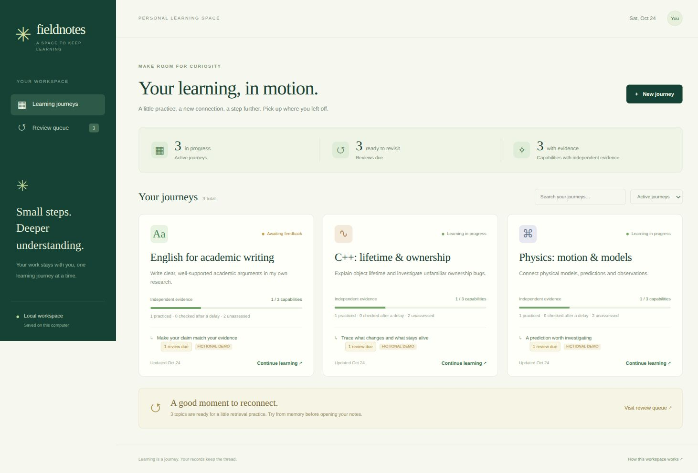

# Verification — 24 October 2026

This verifies the implementation and fictional workflows. It does not establish
teaching effectiveness or assess the developer. The default `courses/` remains
empty; all demonstration/QA responses live in separate temporary directories.

## Completed

- **46 Python regression tests passed** on Python 3.12.3/Linux. Tests cover atomic
  hash-linked histories, concurrent writers, course relocation, fresh-process
  resumption, stale publication, graph dependencies, scope revisions, source
  integrity, immutable activities, chat-only tasks, raw attachments, retry
  identities, observed help, criterion coverage, reassessment, review timing,
  prototype evidence dimensions, draft conflicts and HTTP boundaries.
- All three skills pass skill-creator's `quick_validate.py`. This verifies metadata
  and structure, not autonomous teaching judgment or skill-selection reliability.
- JavaScript syntax checks pass for dashboard, activity host and capture bridge.
- Real native C and C++ programs compiled and produced `42`; timeout handling
  killed a bounded deliberately stalled subprocess.
- A private temporary JupyterLab 4.6.4 environment launched an authenticated server
  through the new workbench. Real REST/session and WebSocket kernel operations
  executed Python, `%%c`, `%%cpp` and `%%sh`. An editable copy survived reopening,
  the published notebook stayed unchanged, and execution wrote no learner events.
  No global Python installation was modified. The selected-venv symlink regression
  is covered by a focused test.
- Edge graphical checks verified dashboard rendering, search, course navigation,
  capability/source views, due-review handoffs and new unassessed goal creation.
- In a sandboxed custom HTML activity, a literal fictional prediction and control
  state saved and restored on reload. Displayed help and declared assistance were
  preserved on submission. A fresh CLI invocation read the exact response, recorded
  separate feedback and cleared the pending queue without awarding guided work
  independent or delayed credit. Feedback then appeared in the browser.
- A phone-width browser check (390px viewport setting, 375px document layout)
  showed no horizontal overflow. Desktop and mobile controls remained accessible.
- Ordinary dashboard/activity browsing produced no captured JavaScript errors.
- A fresh fictional demonstration was generated from the final tools in a separate
  folder. The dashboard preview below shows explicitly fictional records.



## Reproduce

```sh
python3 -m unittest discover -s tests -v
node --check web/app.js
node --check web/activity.js
node --check web/bridge.js
python3 learn.py demo --output /tmp/a-new-fictional-demo
python3 learn.py --courses /tmp/a-new-fictional-demo/courses serve --port 8781
```

The execution sandbox initially blocked local sockets; the HTTP tests passed with
loopback access enabled. Tests do not need external downloads or model calls.
Notebook execution additionally requires a suitable installed environment and native
compilers for the C/C++ examples.

## October 29 Windows workflow update

The Windows regression run now covers session capture/replay, exact UTF-8 text
under legacy console settings, all-or-nothing validation, uncertain-save retries,
observed-help retention, coverage without competence credit, effective review
dates, study budgets and deferred labs, failed chat publication and repair retries.
A separate real Codex sandbox check installs a fictional bundle, reads its skill
references, runs `list`, publishes a chat task and reads the resulting question.
It uses normally inherited staging permissions rather than owner-only temporary
ACLs. No real course evidence is used or generated by these tests.

To run that optional integration check in PowerShell with an available configured
Codex sandbox:

```powershell
$env:FIELDNOTES_SANDBOX_QA = '1'
python -m unittest discover -s tests -p test_windows_access.py -v
```

The earlier Linux/browser results above are historical. The Windows run skips
compiler checks when compilers are absent and symlink checks only when the account
lacks the required privilege. It does not establish teaching effectiveness or
prove the active agent always follows the new testing cadence.

## Remaining boundaries

Runtime tests do not validate instructional decisions. The
[fictional teaching continuations](../tests/behavior_cases.md) provide separate
manual checks of actual next responses, authored tasks and saved records. Judge
the decisions rather than matching phrases; these QA cases are not bundled into
the installed skill and do not establish learning effectiveness.

The Jupyter AI/Codex integration's course instructions, private configuration and
dynamic MCP settings were checked in tests. A live AI request, rendered notebook
chat, notebook MCP operations and a fresh installation of the AI dependencies were
not tested in this new harness. Its earlier source integration has its own separate
historical validation; those results are not attributed to this version.

Actual Android/Termux execution, microphone recording, physical laboratory work
and large media/corpus workloads remain unvalidated. Windows core tools are now
covered by the workflow update above; optional Jupyter and compiler integrations
have not been validated on Windows. Browser file
attachments were tested through the HTTP contract, not through the graphical file
picker. Markdown rendering is a small escaped subset. More sophisticated math,
diagrams, source figures or interactions should use an appropriate authored surface.

The dashboard is a local, single-user application. It provides no multi-user
authentication, remote hosting, external notifications or automatic agent wakeup.
The active agent remains responsible for inspecting sources and judging learning.
There has been no real learner pilot or observed retention study.
